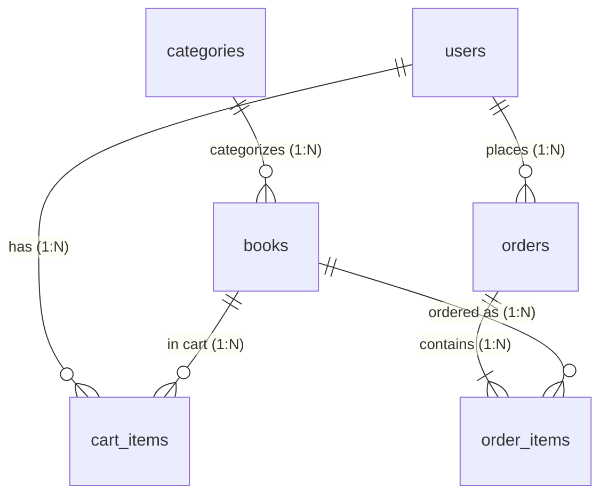

# Data Model: Online Bookstore Core Schemas (3NF)

## 1. Relational Entities (6 Common Tables)

### 1. `categories`
Stores product categories.
- `id`: INTEGER PRIMARY KEY AUTOINCREMENT
- `name`: TEXT NOT NULL UNIQUE
- `slug`: TEXT NOT NULL UNIQUE
- `created_at`: TEXT NOT NULL DEFAULT CURRENT_TIMESTAMP

### 2. `books`
Stores the book catalog.
- `id`: INTEGER PRIMARY KEY AUTOINCREMENT
- `category_id`: INTEGER NOT NULL REFERENCES categories(id)
- `title`: TEXT NOT NULL
- `author`: TEXT NOT NULL
- `isbn`: TEXT NOT NULL UNIQUE
- `description`: TEXT
- `price_cents`: INTEGER NOT NULL CHECK (price_cents >= 0)
- `stock`: INTEGER NOT NULL CHECK (stock >= 0)
- `created_at`: TEXT NOT NULL DEFAULT CURRENT_TIMESTAMP

### 3. `users`
Customer accounts.
- `id`: INTEGER PRIMARY KEY AUTOINCREMENT
- `email`: TEXT NOT NULL UNIQUE
- `name`: TEXT NOT NULL
- `created_at`: TEXT NOT NULL DEFAULT CURRENT_TIMESTAMP

### 4. `orders`
Customer orders.
- `id`: INTEGER PRIMARY KEY AUTOINCREMENT
- `user_id`: INTEGER NOT NULL REFERENCES users(id)
- `request_key`: TEXT NOT NULL UNIQUE
- `total_cents`: INTEGER NOT NULL CHECK (total_cents >= 0)
- `status`: TEXT NOT NULL DEFAULT 'pending' CHECK (status IN ('pending', 'paid', 'shipped', 'cancelled'))
- `created_at`: TEXT NOT NULL DEFAULT CURRENT_TIMESTAMP

### 5. `order_items`
Resolves the M:N relationship between Orders and Books.
- `id`: INTEGER PRIMARY KEY AUTOINCREMENT
- `order_id`: INTEGER NOT NULL REFERENCES orders(id) ON DELETE CASCADE
- `book_id`: INTEGER NOT NULL REFERENCES books(id)
- `quantity`: INTEGER NOT NULL CHECK (quantity > 0)
- `price_cents`: INTEGER NOT NULL CHECK (price_cents >= 0)

### 6. `cart_items`
Customer shopping cart items.
- `id`: INTEGER PRIMARY KEY AUTOINCREMENT
- `user_id`: INTEGER NOT NULL REFERENCES users(id) ON DELETE CASCADE
- `book_id`: INTEGER NOT NULL REFERENCES books(id)
- `quantity`: INTEGER NOT NULL CHECK (quantity > 0)
- `created_at`: TEXT NOT NULL DEFAULT CURRENT_TIMESTAMP
- UNIQUE(user_id, book_id)

---

## 2. Cardinality & Relationships

- **Categories ↔ Books**: 1:N (One category has zero or more books; every book belongs to exactly one category).
- **Users ↔ Orders**: 1:N (One user can place many orders).
- **Orders ↔ Books**: M:N resolved via `order_items` associative table.
- **Users ↔ Books (Cart)**: M:N resolved via `cart_items` associative table with unique `(user_id, book_id)`.

---

## 3. 3NF (Third Normal Form) Rationale
1. **1NF**: Every column contains atomic values (no repeating groups, arrays, or comma-separated lists).
2. **2NF**: All non-key attributes are fully functionally dependent on the entire primary key (no partial dependency). In associative tables like `order_items`, `quantity` and historical `price_cents` depend on the specific order item record.
3. **3NF**: No transitive dependencies exist.
   - Book details (e.g., category name) are not stored directly in `books`, but in `categories` referenced by `category_id`.
   - Order details (e.g., user name or email) are not duplicated in `orders`, but referenced via `user_id`.
   - Historical transaction price is preserved in `order_items.price_cents` to prevent changing past order totals when current book prices change.

---

## 4. Key Constraints Checklist
- [x] **`books.stock` CHECK constraint**: `CHECK (stock >= 0)` prevents overselling and negative inventory.
- [x] **`orders.request_key` UNIQUE constraint**: Guarantees payment/order idempotency.
- [x] **Integer Currency Representation**: Amounts stored in integer cents (`price_cents`, `total_cents`) to prevent floating-point calculation errors.
- [x] **Orders ↔ Books M:N**: Normalized through `order_items` with historical unit price snapshot.
