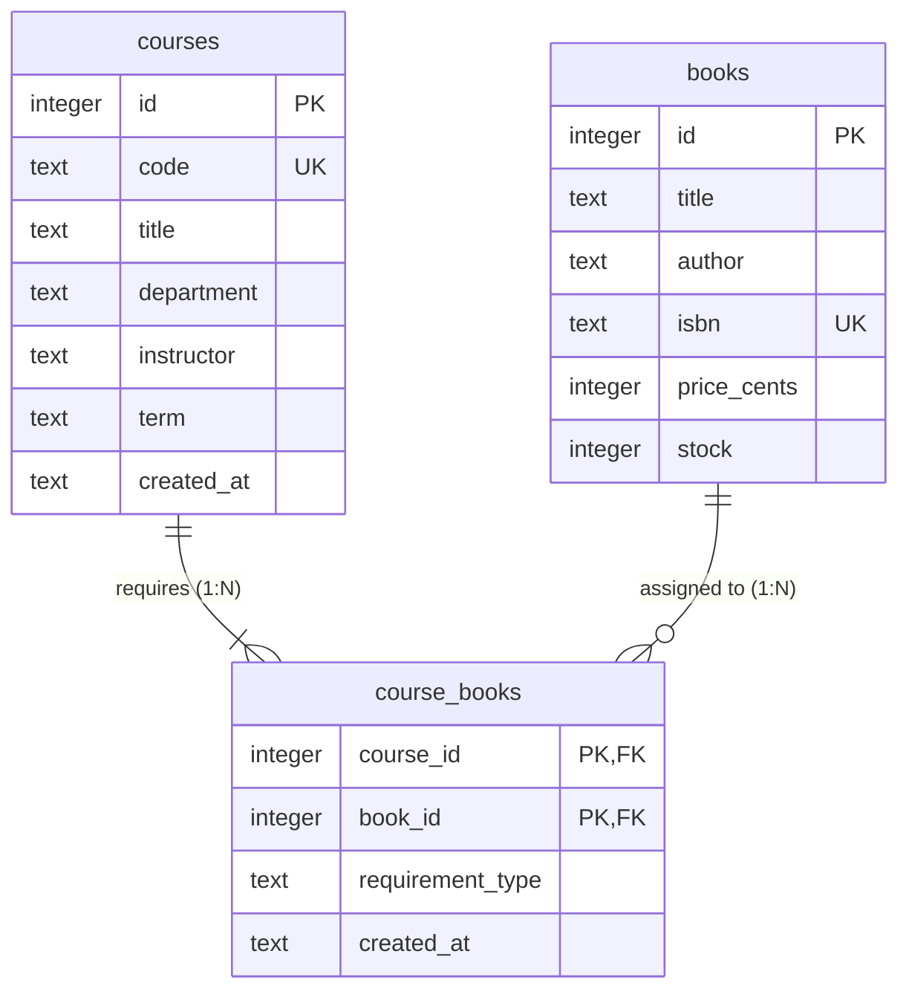

# Feature Specification: 004 - University Textbook Store (Extension)
Spec ID: SPEC-004
Status: Draft (Draft ERD only; No code implementation)
Course Feature: EXT-01 (University Textbook Course Mapping)
Student ID: 2024111

## 1. Feature Description
Enables university students and faculty to view required and recommended textbooks organized by university courses, academic terms, and departments.
Provides syllabus-anchored book listings, course enrollment reading lists, and direct checkout for required course materials.

## 2. Why a New Data Entity is Needed
The core bookstore schema categorizes books by general subject (`categories`), which is insufficient for academic institutions. A single book (e.g. *Database System Concepts*) may be required in multiple distinct courses across departments (e.g. `CS301 Database Systems` in Computer Science and `IS210 Data Management` in Information Systems) across different semesters.
Furthermore, each course has specific metadata (course code, department, instructor, term) and course-book relationship attributes (`requirement_type`: 'required' vs 'recommended'). This necessitates a many-to-many relationship between `courses` and `books` resolved through an associative entity `course_books`.

## 3. User Stories
- **US-EXT-01**: As a university student, I want to look up my course code (e.g., `CS301`) to see all required and recommended textbooks.
- **US-EXT-02**: As an instructor, I want to associate existing books in the catalog with my course syllabus so students purchase the correct edition.
- **US-EXT-03**: As a student, I want to see if required textbooks for my courses are currently in stock.

## 4. Draft Acceptance Criteria
- **AC-TEXTBOOK-01**: Querying a valid course code (e.g., `GET /api/courses/CS301/books`) returns all associated textbooks categorized by requirement type ('required' or 'recommended').
- **AC-TEXTBOOK-02**: A book can be linked to multiple courses without duplicating the book record in `books`.
- **AC-TEXTBOOK-03**: Deleting a course or book cleanly cascades or removes associations in `course_books` without orphaned junction records.

## 5. Draft Data Model & ERD

### Table Definitions

#### `courses`
- `id`: INTEGER PRIMARY KEY AUTOINCREMENT
- `code`: TEXT NOT NULL UNIQUE (e.g., 'CS301')
- `title`: TEXT NOT NULL (e.g., 'Database Systems')
- `department`: TEXT NOT NULL (e.g., 'Computer Science')
- `instructor`: TEXT NOT NULL
- `term`: TEXT NOT NULL (e.g., 'Fall 2026')
- `created_at`: TEXT NOT NULL DEFAULT CURRENT_TIMESTAMP

#### `course_books`
- `course_id`: INTEGER NOT NULL REFERENCES courses(id) ON DELETE CASCADE
- `book_id`: INTEGER NOT NULL REFERENCES books(id) ON DELETE CASCADE
- `requirement_type`: TEXT NOT NULL DEFAULT 'required' CHECK (requirement_type IN ('required', 'recommended'))
- `created_at`: TEXT NOT NULL DEFAULT CURRENT_TIMESTAMP
- PRIMARY KEY (`course_id`, `book_id`)

## 6. Implementation Scope Boundary
> [!NOTE]
> Per Lab 1 instructions, this specification is approved as a design draft only. No code or migration is implemented in this phase.
